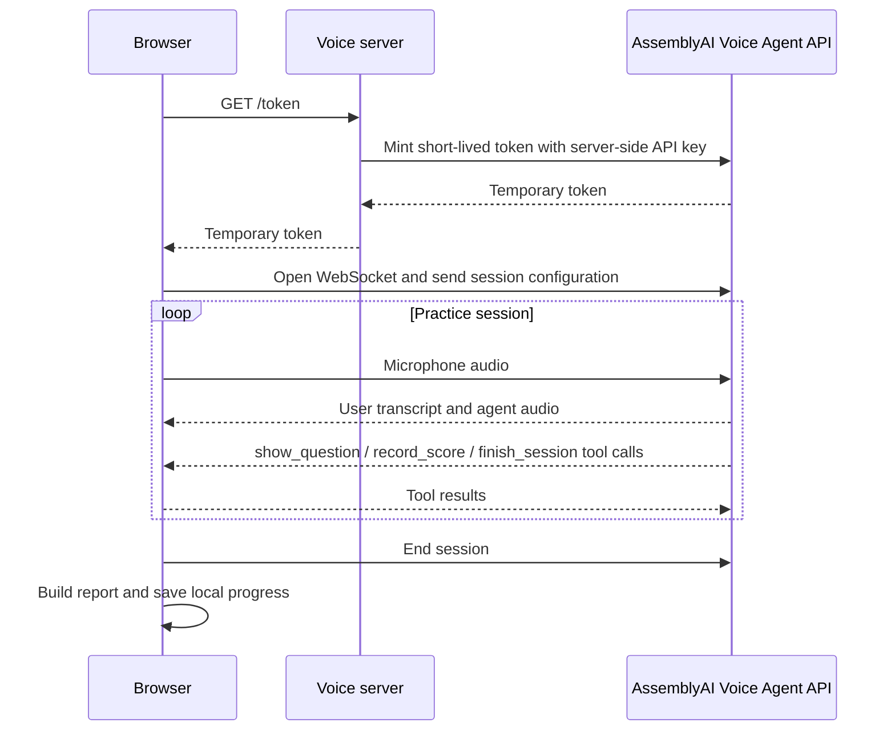

# Voice
Voice is a browser-based practice partner for students, presenters and job seekers. Bring your own notes, syllabus, project material, CV, cover letter or job description, then practise out loud with a live voice agent that asks useful questions, follows up on weak answer
**Turn what you know into confidence.**

Voice is a browser-based practice partner for students, presenters and job seekers. Bring your own notes, syllabus, project material, CV, cover letter or job description, then practise out loud with a live voice agent that asks useful questions, follows up on weak answers and gives you a clear next step.

The product is designed around a simple idea: people improve faster when they have a safe place to retrieve knowledge, explain their thinking and receive specific feedback before the real exam, presentation or interview.

**Made by [Akolo Bulus](https://github.com/akolobulus)** · [LinkedIn](https://www.linkedin.com/in/akolo-bulus/)

---

## The problem

Most preparation is passive:

- Students reread notes but do not practise retrieving or explaining the material.
- People often discover their knowledge gaps only during an exam, presentation or viva.
- Classmates, teachers and mentors cannot provide unlimited one-to-one practice.
- Generic AI answers are not grounded in the learner's own notes or goals.
- Interview practice is often generic and does not test the evidence in a candidate's CV against a specific role.
- Feedback is easy to forget when it is not connected to a measurable next step.

The result is a confidence gap. A learner may recognise information on a page but struggle to recall it, apply it, communicate it clearly or defend it under pressure.

## Our solution

Voice turns a learner's own material into an interactive rehearsal session:

1. **Bring the material that matters.** Paste notes or upload a PDF. Interview candidates can add their CV, cover letter and job description.
2. **Choose the goal.** Study a topic, defend a project or rehearse a job interview.
3. **Practise out loud.** The voice peer asks questions, listens to the response and adapts with follow-ups.
4. **Receive useful feedback.** Answers are assessed against a mode-specific rubric while delivery metrics are collected.
5. **Leave with a plan.** The final report identifies strengths, gaps, a model answer, practice prompts and the most valuable next area to work on.

Voice is not intended to replace a teacher, mentor or recruiter. It gives people a private, repeatable first layer of practice so that their limited time with experts becomes more valuable.

## Practice modes

### Study partner

For exams, revision and learning a new topic. The agent uses retrieval practice, explain-it-simply prompts, application questions and supportive misconception correction. The rubric focuses on:

- Understanding
- Recall
- Application
- Gaps and misconceptions
- Communication

### Project and presentation practice

For project reviews, presentations, vivas and demonstrations. The agent asks questions grounded in the learner's material, challenges vague claims and helps practise a concise, defensible explanation.

### Job interview panel

For candidates preparing for a specific role. Add the job description, CV, cover letter and optional notes. The session uses two interviewer perspectives:

- **Maya** — hiring-manager questions about motivation, role fit and behavioural evidence.
- **Daniel** — technical questions about the role, problem solving and the candidate's experience.

The interview rubric covers role fit, technical knowledge, problem solving, behavioural examples and communication.

## Core features

- **Own-material practice:** paste notes or extract text from a PDF in the browser.
- **Live voice conversation:** speech recognition, turn detection, agent speech and interruption support through the AssemblyAI Voice Agent API.
- **Adaptive questioning:** follow-ups are based on what you actually said, not a fixed question list.
- **Live scoring:** the agent records evidence and feedback against the active rubric without reading private scoring notes aloud.
- **Delivery coaching:** track pace, filler words, thinking time and answer timing from the live transcript.
- **Thinking-time control:** allow longer pauses so a thoughtful answer is not cut off prematurely.
- **Rambling protection:** long answers can trigger a concise intervention, helping practise clear communication.
- **Model answer:** compare your weakest response with a stronger answer built from your own material.
- **Progress history:** session scores, delivery metrics and weak areas are stored locally in the browser.
- **Drill practice:** start another session focused on the weakest criterion from the report.
- **Exportable report:** review the report in the app, export it as Markdown or print it to PDF.
- **Responsive experience:** designed for phone, tablet and desktop use.
- **Reduced-motion support:** animation-heavy surfaces respect the user's reduced-motion preference.

## Privacy and security

- The AssemblyAI API key stays on the server and is never sent to the browser.
- The browser requests a short-lived session token from `/token`.
- PDF text is extracted in the browser; the original PDF is not uploaded by this app.
- Session history is stored in browser `localStorage` on the device where you practise.
- Voice audio and live transcripts are sent to AssemblyAI for the active voice session because that service provides transcription and voice-agent functionality.
- The server rate-limits token requests per IP and supports an optional allowed origin.
- Do not paste passwords, payment details, government identifiers or other sensitive information into practice material.

## How the technical flow works



The browser configures each session with:

- A mode-specific system prompt and rubric.
- The selected voice, persona and question count.
- Key terms extracted from the learner's material to improve technical transcription.
- A transcription prompt describing the topic and context.
- Turn-detection settings, including optional thinking time.
- Client-side tools for questions, scoring and report completion.

## Technology

- Node.js 18+
- Native Node HTTP server with no runtime npm dependencies
- Vanilla HTML, CSS and JavaScript
- AssemblyAI Voice Agent API over WebSocket
- Browser Web Audio APIs for microphone capture and playback
- PDF.js for in-browser PDF text extraction
- Canvas-based particle background and interactive halftone footer
- `node:test` for automated tests

## Run locally

### Requirements

- Node.js 18 or newer
- An AssemblyAI API key with access to the Voice Agent API
- A modern browser with microphone support

### Setup

```bash
git clone https://github.com/akolobulus/Voice.git
cd Voice
```

Create a local `.env` file:

```env
ASSEMBLYAI_API_KEY=your_api_key_here
```

Start the server:

```bash
npm start
```

Open [http://localhost:3000](http://localhost:3000), choose a practice mode, add material or select **Try a sample**, and start a session. Grant microphone permission when prompted.

### Run tests

```bash
npm test
```

The test suite covers server routes, token handling, rate limiting, static path safety, session configuration, key-term extraction, scoring tools, metrics, reports and resilience behaviour.

## Configuration

| Variable | Required | Default | Purpose |
|---|---:|---:|---|
| `ASSEMBLYAI_API_KEY` | Yes | — | Server-side key used to mint temporary Voice Agent tokens |
| `PUBLIC_ORIGIN` | No | unset | Reject token requests from origins other than this value |
| `TRUST_PROXY` | No | unset | Trust proxy headers when deployed behind a configured reverse proxy |
| `TOKENS_PER_HOUR` | No | `20` | Maximum token requests per IP per hour |
| `MAX_SESSION_SECONDS` | No | `1800` | Maximum Voice Agent session duration |

Never commit `.env` or expose the API key in client-side code.

## Deploy

### Vercel

1. Import `https://github.com/akolobulus/Voice`.
2. Add `ASSEMBLYAI_API_KEY` in the project environment variables.
3. Add `TRUST_PROXY=1` when the deployment uses a trusted proxy.
4. Deploy using the included [`vercel.json`](vercel.json).

The Vercel entry point [`api/index.mjs`](api/index.mjs) uses the same request handler as the local server. Static assets are served from [`public/`](public/).

### Render

The repository includes [`render.yaml`](render.yaml) for a Blueprint deployment. Add the required `ASSEMBLYAI_API_KEY` and verify the deployed `/health` endpoint before opening a live practice session.

For production, configure HTTPS, restrict `PUBLIC_ORIGIN`, monitor token usage and rotate keys if they are ever exposed.

## Project structure

```text
server.mjs              HTTP server, environment loading, token minting and static serving
api/index.mjs           Vercel entry point using the shared server handler
vercel.json              Vercel routing and static asset configuration
render.yaml              Render deployment configuration
public/index.html        Setup, live session, report and footer markup
public/app.js            Browser controller and session lifecycle
public/session.js        Prompts, rubrics, tools and Voice Agent configuration
public/audio.js          Microphone capture and audio playback
public/metrics.js        Pace, filler-word and thinking-time calculations
public/toolqueue.js      Safe Voice Agent tool-result timing
public/report.js         Fallback report generation
public/history.js        Local progress history and comparisons
public/pdftext.js        In-browser PDF extraction and section selection
public/ai-background.js  Animated particle and face background
public/footer.js         Interactive halftone footer effect
public/vendor/pdfjs/     Bundled PDF.js assets
test/                    Node test suite
```

## Responsible use and limitations

Voice provides practice feedback, not an official grade, medical advice, legal advice or a hiring decision. AI feedback can be incomplete or wrong, especially when source material is missing or ambiguous. Always verify important academic, professional and technical claims with a trusted source.

For the best results:

- Provide clear, relevant material rather than a single vague sentence.
- Treat the agent's questions as rehearsal, not a prediction of the exact exam or interview.
- Use the report to choose one concrete improvement and practise it again.
- Check microphone permissions and use headphones where possible to reduce echo.

## Roadmap

- More focused study plans and spaced-repetition sessions.
- Richer progress views for topics, criteria and repeated attempts.
- Additional interview-panel roles and configurable interviewer styles.
- More language and voice options.
- Optional account-backed history for people who want progress across devices.
- Accessibility and performance refinements based on real user testing.

## License

This project is available under the [MIT License](LICENSE).
<!-- README revision 1 -->
<!-- README revision 2 -->
<!-- README revision 3 -->
<!-- README revision 4 -->
<!-- README revision 5 -->
<!-- README revision 6 -->
<!-- README revision 7 -->
<!-- README revision 8 -->
<!-- README revision 9 -->
<!-- README revision 10 -->
<!-- README revision 11 -->
<!-- README revision 12 -->
<!-- README revision 13 -->
<!-- README revision 14 -->
<!-- README revision 15 -->
<!-- README revision 16 -->
<!-- README revision 17 -->
<!-- README revision 18 -->
<!-- README revision 19 -->
<!-- README revision 20 -->
<!-- README revision 21 -->
<!-- README revision 22 -->
<!-- README revision 23 -->
<!-- README revision 24 -->
<!-- README revision 25 -->
<!-- README revision 26 -->
<!-- README revision 27 -->
<!-- README revision 28 -->
<!-- README revision 29 -->
<!-- README revision 30 -->
<!-- README revision 31 -->
<!-- README revision 32 -->
<!-- README revision 33 -->
<!-- README revision 34 -->
<!-- README revision 35 -->
<!-- README revision 36 -->
<!-- README revision 37 -->
<!-- README revision 38 -->
<!-- README revision 39 -->
<!-- README revision 40 -->
<!-- README revision 41 -->
<!-- README revision 42 -->
<!-- README revision 43 -->
<!-- README revision 44 -->
<!-- README revision 45 -->
<!-- README revision 46 -->
<!-- README revision 47 -->
<!-- README revision 48 -->
<!-- README revision 49 -->
<!-- README revision 50 -->
<!-- README revision 51 -->
<!-- README revision 52 -->
<!-- README revision 53 -->
<!-- README revision 54 -->
<!-- README revision 55 -->
<!-- README revision 56 -->
<!-- README revision 57 -->
<!-- README revision 58 -->
<!-- README revision 59 -->
<!-- README revision 60 -->
<!-- README revision 61 -->
<!-- README revision 62 -->
<!-- README revision 63 -->
<!-- README revision 64 -->
<!-- README revision 65 -->
<!-- README revision 66 -->
<!-- README revision 67 -->
<!-- README revision 68 -->
<!-- README revision 69 -->
<!-- README revision 70 -->
<!-- README revision 71 -->
<!-- README revision 72 -->
<!-- README revision 73 -->
<!-- README revision 74 -->
<!-- README revision 75 -->
<!-- README revision 76 -->
<!-- README revision 77 -->
<!-- README revision 78 -->
<!-- README revision 79 -->
<!-- README revision 80 -->
<!-- README revision 81 -->
<!-- README revision 82 -->
<!-- README revision 83 -->
<!-- README revision 84 -->
<!-- README revision 85 -->
<!-- README revision 86 -->
<!-- README revision 87 -->
<!-- README revision 88 -->
<!-- README revision 89 -->
<!-- README revision 90 -->
<!-- README revision 91 -->
<!-- README revision 92 -->
<!-- README revision 93 -->
<!-- README revision 94 -->
<!-- README revision 95 -->
<!-- README revision 96 -->
<!-- README revision 97 -->
<!-- README revision 98 -->
<!-- README revision 99 -->
<!-- README revision 100 -->
<!-- README revision 101 -->
<!-- README revision 102 -->
<!-- README revision 103 -->
<!-- README revision 104 -->
<!-- README revision 105 -->
<!-- README revision 106 -->
<!-- README revision 107 -->
<!-- README revision 108 -->
<!-- README revision 109 -->
<!-- README revision 110 -->
<!-- README revision 111 -->
<!-- README revision 112 -->
<!-- README revision 113 -->
<!-- README revision 114 -->
<!-- README revision 115 -->
<!-- README revision 116 -->
<!-- README revision 117 -->
<!-- README revision 118 -->
<!-- README revision 119 -->
<!-- README revision 120 -->
<!-- README revision 121 -->
<!-- README revision 122 -->
<!-- README revision 123 -->
<!-- README revision 124 -->
<!-- README revision 125 -->
<!-- README revision 126 -->
<!-- README revision 127 -->
<!-- README revision 128 -->
<!-- README revision 129 -->
<!-- README revision 130 -->
<!-- README revision 131 -->
<!-- README revision 132 -->
<!-- README revision 133 -->
<!-- README revision 134 -->
<!-- README revision 135 -->
<!-- README revision 136 -->
<!-- README revision 137 -->
<!-- README revision 138 -->
<!-- README revision 139 -->
<!-- README revision 140 -->
<!-- README revision 141 -->
<!-- README revision 142 -->
<!-- README revision 143 -->
<!-- README revision 144 -->
<!-- README revision 145 -->
<!-- README revision 146 -->
<!-- README revision 147 -->
<!-- README revision 148 -->
<!-- README revision 149 -->
<!-- README revision 150 -->
<!-- README revision 151 -->
<!-- README revision 152 -->
<!-- README revision 153 -->
<!-- README revision 154 -->
<!-- README revision 155 -->
<!-- README revision 156 -->
<!-- README revision 157 -->
<!-- README revision 158 -->
<!-- README revision 159 -->
<!-- README revision 160 -->
<!-- README revision 161 -->
<!-- README revision 162 -->
<!-- README revision 163 -->
<!-- README revision 164 -->
<!-- README revision 165 -->
<!-- README revision 166 -->
<!-- README revision 167 -->
<!-- README revision 168 -->
<!-- README revision 169 -->
<!-- README revision 170 -->
<!-- README revision 171 -->
<!-- README revision 172 -->
<!-- README revision 173 -->
<!-- README revision 174 -->
<!-- README revision 175 -->
<!-- README revision 176 -->
<!-- README revision 177 -->
<!-- README revision 178 -->
<!-- README revision 179 -->
<!-- README revision 180 -->
<!-- README revision 181 -->
<!-- README revision 182 -->
<!-- README revision 183 -->
<!-- README revision 184 -->
<!-- README revision 185 -->
<!-- README revision 186 -->
<!-- README revision 187 -->
<!-- README revision 188 -->
<!-- README revision 189 -->
<!-- README revision 190 -->
<!-- README revision 191 -->
<!-- README revision 192 -->
<!-- README revision 193 -->
<!-- README revision 194 -->
<!-- README revision 195 -->
<!-- README revision 196 -->
<!-- README revision 197 -->
<!-- README revision 198 -->
<!-- README revision 199 -->
<!-- README revision 200 -->
<!-- README revision 201 -->
<!-- README revision 202 -->
<!-- README revision 203 -->
<!-- README revision 204 -->
<!-- README revision 205 -->
<!-- README revision 206 -->
<!-- README revision 207 -->
<!-- README revision 208 -->
<!-- README revision 209 -->
<!-- README revision 210 -->
<!-- README revision 211 -->
<!-- README revision 212 -->
<!-- README revision 213 -->
<!-- README revision 214 -->
<!-- README revision 215 -->
<!-- README revision 216 -->
<!-- README revision 217 -->
<!-- README revision 218 -->
<!-- README revision 219 -->
<!-- README revision 220 -->
<!-- README revision 221 -->
<!-- README revision 222 -->
<!-- README revision 223 -->
<!-- README revision 224 -->
<!-- README revision 225 -->
<!-- README revision 226 -->
<!-- README revision 227 -->
<!-- README revision 228 -->
<!-- README revision 229 -->
<!-- README revision 230 -->
<!-- README revision 231 -->
<!-- README revision 232 -->
<!-- README revision 233 -->
<!-- README revision 234 -->
<!-- README revision 235 -->
<!-- README revision 236 -->
<!-- README revision 237 -->
<!-- README revision 238 -->
<!-- README revision 239 -->
<!-- README revision 240 -->
<!-- README revision 241 -->
<!-- README revision 242 -->
<!-- README revision 243 -->
<!-- README revision 244 -->
<!-- README revision 245 -->
<!-- README revision 246 -->
<!-- README revision 247 -->
<!-- README revision 248 -->
<!-- README revision 249 -->
<!-- README revision 250 -->
<!-- README revision 251 -->
<!-- README revision 252 -->
<!-- README revision 253 -->
<!-- README revision 254 -->
<!-- README revision 255 -->
<!-- README revision 256 -->
<!-- README revision 257 -->
<!-- README revision 258 -->
<!-- README revision 259 -->
<!-- README revision 260 -->
<!-- README revision 261 -->
<!-- README revision 262 -->
<!-- README revision 263 -->
<!-- README revision 264 -->
<!-- README revision 265 -->
<!-- README revision 266 -->
<!-- README revision 267 -->
<!-- README revision 268 -->
<!-- README revision 269 -->
<!-- README revision 270 -->
<!-- README revision 271 -->
<!-- README revision 272 -->
<!-- README revision 273 -->
<!-- README revision 274 -->
<!-- README revision 275 -->
<!-- README revision 276 -->
<!-- README revision 277 -->
<!-- README revision 278 -->
<!-- README revision 279 -->
<!-- README revision 280 -->
<!-- README revision 281 -->
<!-- README revision 282 -->
<!-- README revision 283 -->
<!-- README revision 284 -->
<!-- README revision 285 -->
<!-- README revision 286 -->
<!-- README revision 287 -->
<!-- README revision 288 -->
<!-- README revision 289 -->
<!-- README revision 290 -->
<!-- README revision 291 -->
<!-- README revision 292 -->
<!-- README revision 293 -->
<!-- README revision 294 -->
<!-- README revision 295 -->
<!-- README revision 296 -->
<!-- README revision 297 -->
<!-- README revision 298 -->
<!-- README revision 299 -->
<!-- README revision 300 -->
<!-- README revision 301 -->
<!-- README revision 302 -->
<!-- README revision 303 -->
<!-- README revision 304 -->
<!-- README revision 305 -->
<!-- README revision 306 -->
<!-- README revision 307 -->
<!-- README revision 308 -->
<!-- README revision 309 -->
<!-- README revision 310 -->
<!-- README revision 311 -->
<!-- README revision 312 -->
<!-- README revision 313 -->
<!-- README revision 314 -->
<!-- README revision 315 -->
<!-- README revision 316 -->
<!-- README revision 317 -->
<!-- README revision 318 -->
<!-- README revision 319 -->
<!-- README revision 320 -->
<!-- README revision 321 -->
<!-- README revision 322 -->
<!-- README revision 323 -->
<!-- README revision 324 -->
<!-- README revision 325 -->
<!-- README revision 326 -->
<!-- README revision 327 -->
<!-- README revision 328 -->
<!-- README revision 329 -->
<!-- README revision 330 -->
<!-- README revision 331 -->
<!-- README revision 332 -->
<!-- README revision 333 -->
<!-- README revision 334 -->
<!-- README revision 335 -->
<!-- README revision 336 -->
<!-- README revision 337 -->
<!-- README revision 338 -->
<!-- README revision 339 -->
<!-- README revision 340 -->
<!-- README revision 341 -->
<!-- README revision 342 -->
<!-- README revision 343 -->
<!-- README revision 344 -->
<!-- README revision 345 -->
<!-- README revision 346 -->
<!-- README revision 347 -->
<!-- README revision 348 -->
<!-- README revision 349 -->
<!-- README revision 350 -->
<!-- README revision 351 -->
<!-- README revision 352 -->
<!-- README revision 353 -->
<!-- README revision 354 -->
<!-- README revision 355 -->
<!-- README revision 356 -->
<!-- README revision 357 -->
<!-- README revision 358 -->
<!-- README revision 359 -->
<!-- README revision 360 -->
<!-- README revision 361 -->
<!-- README revision 362 -->
<!-- README revision 363 -->
<!-- README revision 364 -->
<!-- README revision 365 -->
<!-- README revision 366 -->
<!-- README revision 367 -->
<!-- README revision 368 -->
<!-- README revision 369 -->
<!-- README revision 370 -->
<!-- README revision 371 -->
<!-- README revision 372 -->
<!-- README revision 373 -->
<!-- README revision 374 -->
<!-- README revision 375 -->
<!-- README revision 376 -->
<!-- README revision 377 -->
<!-- README revision 378 -->
<!-- README revision 379 -->
<!-- README revision 380 -->
<!-- README revision 381 -->
<!-- README revision 382 -->
<!-- README revision 383 -->
<!-- README revision 384 -->
<!-- README revision 385 -->
<!-- README revision 386 -->
<!-- README revision 387 -->
<!-- README revision 388 -->
<!-- README revision 389 -->
<!-- README revision 390 -->
<!-- README revision 391 -->
<!-- README revision 392 -->
<!-- README revision 393 -->
<!-- README revision 394 -->
<!-- README revision 395 -->
<!-- README revision 396 -->
<!-- README revision 397 -->
<!-- README revision 398 -->
<!-- README revision 399 -->
<!-- README revision 400 -->
<!-- README revision 401 -->
<!-- README revision 402 -->
<!-- README revision 403 -->
<!-- README revision 404 -->
<!-- README revision 405 -->
<!-- README revision 406 -->
<!-- README revision 407 -->
<!-- README revision 408 -->
<!-- README revision 409 -->
<!-- README revision 410 -->
<!-- README revision 411 -->
<!-- README revision 412 -->
<!-- README revision 413 -->
<!-- README revision 414 -->
<!-- README revision 415 -->
<!-- README revision 416 -->
<!-- README revision 417 -->
<!-- README revision 418 -->
<!-- README revision 419 -->
<!-- README revision 420 -->
